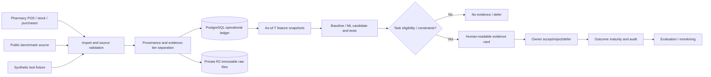

# B-SMART — Implementation, Experiments and Product Execution Blueprint
**Research working plan · 25 October 2026 · Not experimental results**

Companion dataset decision: [RESEARCH_DATASET_DECISION_2026-10-25.md](RESEARCH_DATASET_DECISION_2026-10-25.md). Submitted report source archive: [2026-10-25_user_submitted_report.tex](../thesis_report/archive/2026-10-25_user_submitted_report.tex). The uploaded PDF has 75 pages; Chapter 4 (Implementation) and Chapter 5 (Experimental Results) are still placeholders.

## 0. Non-negotiable research boundaries

1. **Scope:** Bangladesh retail pharmacy is the empirical vertical. Seven synthetic app sectors are not real seven-sector validation.
2. **No fabrication:** do not invent records, unavailable stock, consent, customer IDs, historical prices, costs, labels, results, p-values, coverage or financial uplift.
3. **Freeze data** before the final time holdout. Fit scalers/imputation/target encodings/feature selection only on training folds. Log every exclusion and failed experiment, including contrary benchmark outcomes.
4. **No leakage:** the "as of" time of a feature must be before the forecast/decision cutoff. Availability timestamps and last-known prices must be tracked separately from event timestamps.
5. **Always compare** simple baselines and policies, not only the ML approach. If a simple policy wins, the software must use it.
6. **Consent and privacy:** raw business/customer/transactional data remain in restricted private storage. Public GitHub contains schemas, pipeline source, aggregate outputs and synthetic examples only.
7. **Operational use:** recommendations about inventory, not clinical diagnosis/prescriptions; verified manufacturer/product reference data do not justify automated clinical decisions.

## 1. Dataset roles per report research question

| RQ | Main evaluation unit | Main evidence | Secondary data | Unavailable without new evidence |
|---|---|---|---|---|
| RQ1 — forecast | (org, branch, SKU, daily forecast origin) | Tier 1 pharmacy invoices + availability/stock movements | FreshRetailNet-50K stockouts; dunnhumby/UCI general retail; local BD one-product demand | Pharmacy-domain transfer/generalisation |
| RQ2 — future inactivity | (org-scoped pseudonymous customer, decision cutoff, follow-up) | Tier 1 repeat-customer pharmacy transactions with consent where needed | UCI Online Retail II, dunnhumby households for method testing | Local customer-propensity accuracy until field data |
| RQ3 — constrained actions | (branch, SKU, forecast origin, owner rules, available stock) | Tier 1 stock, lot, purchases, budget, costs, lead times, actual owner baseline | FreshRetailNet for stockout stress test; synthetic what-if scenarios | Realised savings without field trial or observed outcomes |
| RQ4 — human decision quality | (owner/operator, task, condition) | Consented users performing counterbalanced tasks | Synthetic *scenarios* are allowed, not hypothetical *participants* | Task correctness/usability evidence until user study |

## 2. Frozen experiment registry (planned, not yet executed)

| ID | Experiment and data | Baselines / comparator | Prespecified primary outcome | Output artifact |
|---|---|---|---|---|
| E01 | Source-level schema audit for every dataset; real/synthetic distinctly labelled | Dataset expected schema | % valid rows, missingness and exclusion log | `research/runs/E01/quality.json` |
| E02 | Existing UCI + optional dunnhumby RQ2 portability, chronological cohort cutoffs | Majority/base rate, recency heuristic, logistic regression | **PR-AUC** with prevalence + Brier and Lift@10% secondary | `research/runs/E02/metrics.json` |
| E03 | Existing BD one-product daily demand | Last observation, seasonal naive, rolling mean, optionally ETS | **WAPE or MASE** chosen for scale/denominator reasons before final test | `research/runs/E03/metrics.json` |
| E04 | FreshRetailNet subset, true stockout labels withheld from forecast-time features | Seasonal naive + zero/flat extrapolation + simple lag model | Out-of-time error and stockout/availability strata | `research/runs/E04/metrics.json` |
| E05 | Pharmacy canonical import with a **fully synthetic fixture** | Referential/ledger reconciliation | Pass/fail acceptance gates, import loss rate, rule violations | `research/runs/E05/validation.json` |
| E06 | Consent-based pharmacy data, time-based SKU forecasts | Seasonal naive, intermittent baseline (where suitable), statistical baseline | Out-of-time **WAPE/MASE** chosen *a priori* | `research/runs/E06/metrics.json` |
| E07 | Consent-based pharmacy customer cohorts, only if eligible | Prevalence, recency rule, logistic regression | **PR-AUC**, calibration/Brier | `research/runs/E07/metrics.json` |
| E08 | Pooled vs per-shop vs shop-adapted pharmacy model | Same eligible baseline and fixed rolling origins | Per-shop and held-out-shop paired forecast error | `research/runs/E08/metrics.json` |
| E09 | Feasible recommendation policies on same observed/replayed demand | Existing owner policy, reorder-point and no-action | **Total inventory-related cost** with sensitivity bands; stockout units | `research/runs/E09/policy.json` |
| E10 | Owner interface study, same tasks with/without evidence contract | Output only versus explanation/evidence | **Task correctness**; time and usability secondary | `research/runs/E10/usability.json` |
| E11 | Software repeatability/security/scalability | Established QA thresholds | Integrity/isolation/latency/error rates | `research/runs/E11/qa.json` |

Do not write any E01–E11 artifact until it has genuinely been executed. The prior `EXP-001` and grocery `EXP-D093B701` are *legacy synthetic exploratory results*; keep their identity and validation caveats, not silently rename them E06 or E08.

### E02 data/label guardrails

- Define a future inactivity horizon H (e.g. 60 or 90 days), but **freeze H before running the final holdout**; label only customers observed to have adequate follow-up. A missing future event due to end of data is **right-censoring**, not automatically churn.
- Multiple snapshots per customer must not be randomly split across training/validation; no features or target leakage from future purchases. Evaluate on later time windows and, where possible, unseen business entities.
- Define the denominator, handle missing customer IDs explicitly and publish calibration curves only from held-out predictions. If no RQ2-eligible customer history exists for real pharmacies, report "not evaluated".

### E03/E04/E06/E08 forecast protocol

- Fix one or more operational horizons by actual lead time (e.g. H = 7/14/28 days, as available), aggregate branch–SKU–day with a documented zero-versus-stockout rule.
- Use chronological splits with expanding/rolling origins and an untouched final test segment; assess cold start separately.
- Baselines: seasonal naive (weekly), trailing mean, intermittent demand baseline if justified; compare to HistGradientBoosting / XGBoost or regularised regressors only when their training size supports them.
- Primary: WAPE or MASE selected *before test opening*. Secondary: MAE, RMSE, bias, interval coverage, errors by intermittent and stockout strata. Provide paired errors and confidence intervals with time-block resampling, not record-wise iid bootstrap.
- FreshRetailNet is not a Bangladeshi pharmacy domain: declare any stockout benefit as a **fresh-retail external benchmark**, not pharmacy impact.

### E09 policy study

- Inputs include units on hand, pending orders, shelf-life/expiry/lot restrictions, minimum pack/MOQ, supplier lead times, purchasing budget, risk bounds and cost assumptions with provenance/effective dates.
- Compare owner's actual ordering policy or a documented rule on exactly the same historical demand path and starting inventory; use a **transparent simulation** if costs and counterfactuals are hypothetical. State whether lead time is observed, estimated or assumed.
- Evaluation: stockout units/days, average on-hand, expired value, procurement/holding/shortage costs if observed or defensibly bounded; accepted recommendations, reasons and matured outcomes when collected. **Never translate a simulated cost change into measured real profit**.

### E10 owner study

- Counterbalanced matched decision tasks with explanation/evidence vs output-only conditions; valid decisions include **defer or reject**.
- Log anonymised participant_id, task_id, condition, correctness, completion time, confidence, error and optional feedback; ethics/consent are prerequisites. The analyst must not invent respondents, task answers or acceptance statistics.

## 3. Dataset manifest contract before model runs

Save a versioned record **per physical source**:

```json
{
  "dataset_id": "example-versioned-id",
  "name": "upstream dataset or consenting shop",
  "evidence_tier": "primary_real | public_real | synthetic",
  "source_url_or_agreement_id": "immutable source link or private agreement ID",
  "upstream_version": "specified release",
  "license_or_permission": "verified permission",
  "retrieved_at_utc": null,
  "sha256": null,
  "file_count": null,
  "raw_rows": null,
  "clean_rows": null,
  "date_min": null,
  "date_max": null,
  "feature_availability_map": {},
  "missingness": {},
  "exclusions": {},
  "transform_code_commit": null,
  "eligible_rqs": [],
  "holdout_policy": null,
  "status": "candidate_not_downloaded"
}
```

`null` means **not measured**. Do not fill in downloaded size, hash, actual rows or numeric outcomes based on a website description. Use one registered dataset version per result.

## 4. Minimum software architecture connected to honest research



**Product development priority** (the app exists but is not evidence-complete):

1. **Data foundation and reliability**: persistent PostgreSQL for users/organizations/operational records, tenant isolation and password policies; private R2 for files/experiment artifacts; tested restore and backups. *A working R2 bucket alone does not make Render ephemeral uploads persistent*: Render must have private storage credentials and end-to-end tests.
2. **Core pharmacy operations**: POS invoices/returns, SKU/product master, supplier receipts, stock movements, batch/expiry, FEFO, audit, payments, reconciliation and permissions. Check live functionality **rather than trusting page count**.
3. **Analytics after valid data**: KPI integrity and date cutoffs; customer RFM/inactivity only for eligible source; demand baselines before ML and safe fallback.
4. **Explainable policy**: batch-aware reorder, near-expiry and customer outreach conditional on observed evidence, cost assumptions and consent; an explicit unavailable/no-action state if critical inputs missing.
5. **Evaluation and traceability**: versioned models, datasets, experiments, paired tables, failure logs, import quality board and authenticated research portal; support download of reproduction package metadata.
6. **Future verticals**: grocery, clothing etc require new schemas, scope and independent evaluation; do not assert that pharmacy model directly generalises.

## 5. Implementation chapter (Chapter 4) writing outline — evidence dependent

**4.1 Environment and deployment:** stack versions, Windows/dev reproduction, Docker, deployed architecture and honest storage boundaries.  
**4.2 Canonical operational schema:** ERD, constraint snapshots, lot/batch audit, normalized entities and tenant separation.  
**4.3 Dataset acquisition and preprocessing:** provenance + source matrix, missingness, exclusions, date cutoffs, feature eligibility.  
**4.4 Feature and model implementation:** RFM, churn labels, demand features, training-only transforms, baseline ladder, calibration.  
**4.5 B-SMART decision engine:** formulas, hard feasibility gates, no-action mode, explanation evidence, owner outcome event.  
**4.6 UI and user workflows:** actual screenshot evidence (owner, cashier, research), permissions, import and interpretation.  
**4.7 Reproducibility/security/testing:** repeatable commands, CI result, real versions, permissions and data privacy.  
**4.8 Known limitations:** all deviations from intended plan; unsupported RQs and fields flagged visibly.

Include only **implemented and tested** features; screenshots alone do not prove correct back-end logic. Annotate features as implemented/partial/proposed, with commit and acceptance test.

## 6. Experimental Results chapter (Chapter 5) writing outline — wait for actual outputs

**5.1 Datasets & evidence tiers:** rows, time span, source, missingness, ethics and eligibility table.  
**5.2 EDA and sanity:** seasonality, inactivity label prevalence, intermittent demand, stockout, class balance, leakage tests.  
**5.3 RQ1:** per-source/per-shop baseline vs model paired errors with uncertainty; do not pool incompatible verticals.  
**5.4 RQ2:** held-out customer label metrics and reliability; ineligible cohorts marked N/A.  
**5.5 RQ3:** policy feasibility and cost/stress simulation, clearly distinguishing observed from assumed and field outcomes.  
**5.6 RQ4:** consented owner paired decision tests, task correctness/time/confidence.  
**5.7 Ablation/robustness:** context, price, expiry/lead time where recorded; sensitivity, stockout and scarce-history strata.  
**5.8 Error analysis:** cancelled/returned invoices, missing customer IDs, unknown stock, short histories and failed model runs.  
**5.9 Threats/limitations and claims matrix:** reproducibility hashes, no claims outside observed population and trial window.

Tables and figures **must come from machine-readable completed run artifacts**. Missing results become explicit "Not yet available", never guessed numbers. The uploaded current report's Chapters 4 and 5 remain untouched by this document.

## 7. Suggested execution schedule (milestone-based, not promised dates)

- **Milestone A:** supervisor signs off initial pharmacy-only scope, exact RQ acceptance criteria and primary metrics; obtain ethics approval/data agreements.
- **Milestone B:** research quality gate for present UCI/Mendeley/WFP + synthetic artifacts, version hashes, rerun all baseline commands and independently inspect discrepancies.
- **Milestone C:** choose and download licensed Complete Journey variant; full quality audit; verify its raw licence, schema and time-index semantics; use public RQ1/RQ2 with no pharmacy claim.
- **Milestone D:** download FreshRetailNet-50K and run leak-free stockout experiments; scale sampled data according to compute budget, record subset choice before test.
- **Milestone E:** partner pharmacies data ingestion; start one partner for schema/invoice reconciliation, expand to 3–5 for held-out-shop design.
- **Milestone F:** freeze data/test, run E06–E09; capture consenting owner task study E10; archive failures and figures.
- **Milestone G:** finish the thesis Chapter 4–5, limitations and reproducibility appendix using actual records; update product roadmap using empirically supported tradeoffs.

## 8. Definition of research completion

Research is **not** complete simply because seven datasets are available in the research portal or because a website deploy is live. Minimum defensible exit conditions:

- sources licensed/permissioned, provenance manifest and SHA-256 complete;
- RQ1–RQ4 each marked **evaluated with measured results** or **not evaluable with explicit limitation**;
- no mixing of synthetic and real evidence in a performance claim;
- at least one auditable chronological public benchmark, ideally consenting local pharmacy partner results for core domain claims;
- a baseline and candidate compared on same data/windows with honest failed runs;
- usable business process demonstrated by staff with audit and tenant isolation;
- thesis report Chapter 4 and Chapter 5 include only verified results, with tables generated from run IDs;
- supervisor reviews narrowing of claims if target participant recruitment cannot be completed.

## 9. Official and researcher-provided sources

- Full current report uploaded by authors, 25 October 2026 — stored at `thesis_report/archive/2026-10-25_user_submitted_report.tex`.
- UCI Online Retail II: https://archive.ics.uci.edu/dataset/502/online+retail+ii
- Mendeley Bangladesh retailer: https://data.mendeley.com/datasets/xwmbk7n3c8/1
- WFP price data: https://data.humdata.org/dataset/wfp-food-prices-for-bangladesh
- Local medicine metadata: https://data.mendeley.com/datasets/zhtvkny53n/1
- 84.51° Complete Journey variants: https://github.com/bradleyboehmke/completejourney ; https://www.kaggle.com/datasets/frtgnn/dunnhumby-the-complete-journey
- FreshRetailNet-50K: https://huggingface.co/datasets/Dingdong-Inc/FreshRetailNet-50K
- Project's own real-data gate: `docs/REAL_DATA_PROTOCOL.md` and `docs/REAL_DATA_SOURCES.md`

> This plan introduces **zero fabricated experiments or synthetic results**. Its status is "planning + proposed experiment protocol". It does not assert that the public candidate datasets have been downloaded or the final empirical thesis validated.
